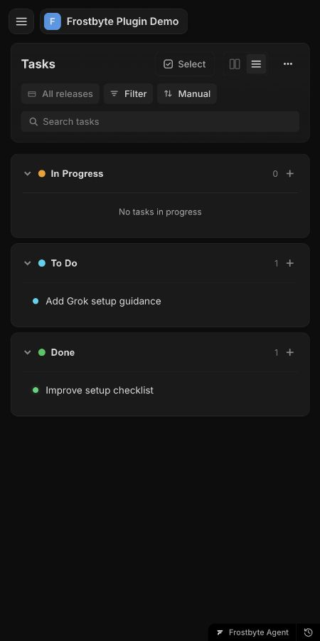

<p align="center"></p>

# Keep Frostbyte up to date as you build.

Pick a task, build it, and keep your board, areas and releases accurate from your
agent. Requires a [Frostbyte](https://getfrostbyte.dev) account with Indie or higher access.

> “Start the setup checklist task and keep it updated.”
>
> Demo result: the agent started the task, added the connection check, verified the
> JSON, and marked it Done. The separate planned task stayed To Do.

<p></p>

Captured from a real Codex/MCP demo run with isolated sample data. Fresh directory
installation checks are still pending.

| Use Frostbyte in | Connect |
| --- | --- |
| ChatGPT | [OAuth setup](docs/setup.md#chatgpt-and-codex) · public directory release in preparation |
| Codex | [OAuth and local setup](docs/setup.md#chatgpt-and-codex) · public directory release in preparation |
| Claude chat | [Connector setup](docs/setup.md#claude-chat) · directory release in preparation |
| Claude Code | [Install from the marketplace](docs/setup.md#claude-code) |

Claude Code 2.1.275 or newer supports one-step installation:

```text
/plugin install frostbyte --marketplace Sky-Enterprises/frostbyte-plugin
```

Try:

- “What should I work on next in this project?”
- “Start this Frostbyte task and keep it updated as you build.”
- “Draft release notes for v1.18.0, but don't publish it.”

The plugin supplies workflow guidance; the [hosted MCP server](https://getfrostbyte.dev/docs/mcp-server)
reads and writes your Frostbyte projects. You choose the work. The agent tracks
agreed tasks, checks completion, and discusses release readiness with you. User
Signals are supported too. Subscriptions are purchased on the website.

[Setup and troubleshooting](docs/setup.md) · [Support](https://getfrostbyte.dev/contact) ·
[Changelog](CHANGELOG.md) · [Maintainer releases](docs/releasing.md) · [MIT](LICENSE)
