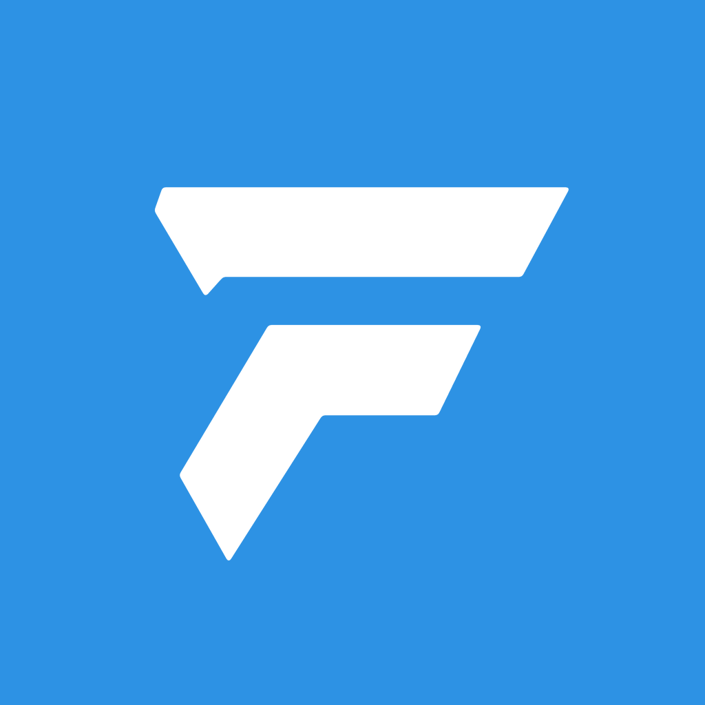
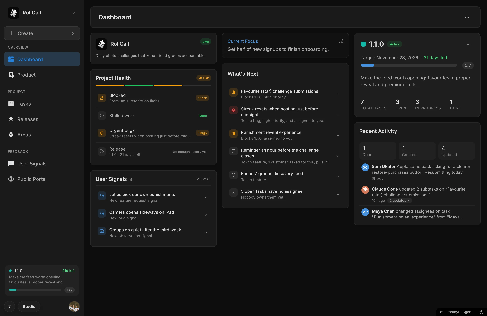
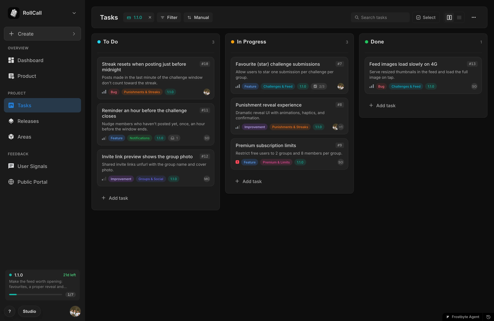
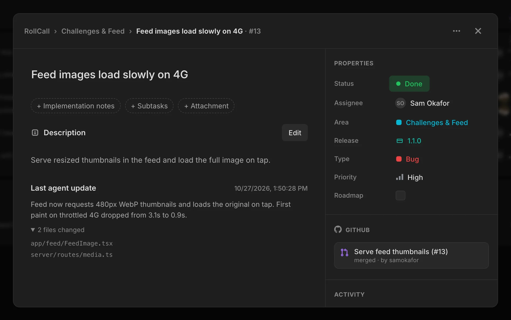

<p align="center">
  <a href="https://getfrostbyte.dev"></a>
</p>

<h1 align="center">Frostbyte for Claude Code, Codex and Cursor</h1>

<p align="center"><strong>The product workspace for software teams and their agents.</strong></p>

<p align="center">
  <a href="https://github.com/Sky-Enterprises/frostbyte-plugin/releases"></a>
  <a href="https://registry.modelcontextprotocol.io/v0/servers?search=dev.getfrostbyte"></a>
  <a href="LICENSE"></a>
</p>

<p align="center">
  <a href="https://getfrostbyte.dev">Website</a> ·
  <a href="https://getfrostbyte.dev/docs/connect-your-agent">Docs</a> ·
  <a href="docs/setup.md">Setup</a> ·
  <a href="CHANGELOG.md">Changelog</a> ·
  <a href="https://getfrostbyte.dev/contact">Support</a>
</p>

<p align="center"></p>

## What is Frostbyte?

Frostbyte is a product planning workspace for founders and small teams who build software with AI coding agents like Claude Code, Codex and Cursor. It keeps tasks, releases, ideas, user feedback and decisions in one plan. What's Next ranks what to work on, Project Health shows whether the release is on track, and your agent connects over MCP to read the plan and write progress, notes and decisions back.

This plugin is the official way to connect Claude Code, Codex and Cursor. It works with every Frostbyte account, Free included.

## Install

**Claude Code**

```text
/plugin marketplace add Sky-Enterprises/frostbyte-plugin
/plugin install frostbyte@frostbyte-plugin
```

Paste your API token when asked. You'll find it in Frostbyte under **Settings → Connections → Connect your agent**.

**Codex**

```sh
codex plugin marketplace add Sky-Enterprises/frostbyte-plugin
codex plugin add frostbyte@frostbyte-plugin
codex mcp login frostbyte
```

Your browser opens to sign in to Frostbyte. Prefer a token? See [setup](docs/setup.md#chatgpt-and-codex).

**Cursor**

Cursor reads the plugin from `.cursor-plugin/` in this repository. Until Frostbyte is listed in the Cursor Marketplace, add the server by hand. Put your API token in the `FROSTBYTE_API_TOKEN` environment variable (**Settings → Connections → Connect your agent** in Frostbyte creates it), start Cursor from that environment, and add this to `~/.cursor/mcp.json`:

```json
{
  "mcpServers": {
    "frostbyte": {
      "url": "https://getfrostbyte.dev/mcp",
      "headers": {
        "Authorization": "Bearer ${env:FROSTBYTE_API_TOKEN}",
        "X-Frostbyte-Client": "cursor"
      }
    }
  }
}
```

More in [setup](docs/setup.md#cursor).

**ChatGPT, Claude chat and Grok**

Add `https://getfrostbyte.dev/mcp` as a custom connector and sign in. Steps for [ChatGPT](docs/setup.md#chatgpt-and-codex), [Claude](docs/setup.md#claude-chat) and [Grok](docs/setup.md#grok).

## Try it

```text
What should I work on next?
Start this task and keep it updated as you build.
Plan the next release from the backlog.
What did users ask for this week?
Draft release notes for v1.18.0, but don't publish it.
```

## What your agent can do

| Skill | What it does |
| --- | --- |
| **Tasks** | Picks up the next task, starts it, and logs progress, files changed and decisions as it works. |
| **Planning** | Breaks a goal into tasks and plans releases. Proposes the plan first and writes only after you approve. |
| **Releases** | Shows what's left in a release and drafts release notes. |
| **Signals** | Reviews bug reports and requests from your users and links them to tasks. You make the triage calls. |
| **Areas** | Groups a project's tasks into areas. |
| **Notes** | Leaves a session handoff for the next session and keeps lasting context, such as architecture, in a few project notes. |
| **Onboarding** | Links a repository to a Frostbyte project with a `.frostbyte.json` file. |
| **Docs and support** | Answers how Frostbyte works from the live docs. |

<table>
  <tr>
    <td width="50%"></td>
    <td width="50%"></td>
  </tr>
  <tr>
    <td align="center">Your board, filtered to the next release</td>
    <td align="center">The agent's update on a finished task</td>
  </tr>
</table>

## How it works

- **The plugin** (this repository) adds the skills above, so your agent follows the same workflow every session.
- **The [hosted MCP server](https://getfrostbyte.dev/docs/mcp-server)** at `https://getfrostbyte.dev/mcp` reads and writes your Frostbyte projects. Any MCP client can use it on its own.
- **In Claude Code**, a SessionStart hook reads `.frostbyte.json` so each session starts in the right project. It makes no network calls.

## Pricing

Free to start. No per-seat fees. See [pricing](https://getfrostbyte.dev/pricing). The plugin never takes payments.

## Support

[Setup and troubleshooting](docs/setup.md) · [Contact us](https://getfrostbyte.dev/contact) · [Changelog](CHANGELOG.md) · [Maintainer releases](docs/releasing.md)

MIT licensed. Made by [Sky Enterprises](https://getfrostbyte.dev).
